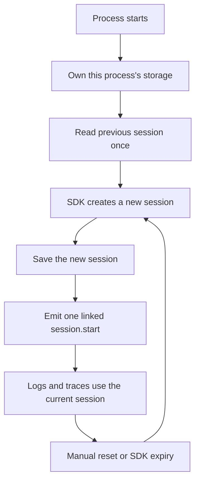

# Android session integration (draft)

Draft integration for [#57](https://github.com/grafana/frontend-o11y-knowledge-workbench/issues/57).
This project is not included in the package build and has no publication task.
It compiles the real Grafana initializer alongside the draft integration, using
unmerged upstream APIs. The package's OTel 1.7.0 dependency and public API stay unchanged.

## Behavior

- Each Android process owns a separate record in `noBackupFilesDir`. Use its stable
  process name, including any `:worker` suffix, not its PID.
- Buffer directories are also process-specific, with `process.title` on telemetry.
  Only the main process keeps native-crash capture; its upstream storage is app-wide.
- A launch creates a new session. The saved session is only the previous-session
  link on the first built-in start event; it is never restored or ended again.
- Manual reset uses the proposed upstream `SessionExtension.startNewSession()`.
  Its Boolean return value is provisional. A rejected concurrent reset is not queued.
- Missing or corrupt data starts fresh. Unknown formats, oversized and unreadable records
  are left untouched. A competing owner or failed write falls back to memory.
- Storage stays owned until shutdown, including when an Activity is destroyed.
  Initialization failure closes it. After shutdown, restart the process instead
  of reinitializing. Stop telemetry callers before shutdown, as with the SDK itself.



`ColdStartSessions` adapts the existing Grafana storage prototype to
[#2126](https://github.com/open-telemetry/opentelemetry-android/pull/2126)'s getter.
The reset integration uses [#2141](https://github.com/open-telemetry/opentelemetry-android/pull/2141),
which builds on [#2037](https://github.com/open-telemetry/opentelemetry-android/pull/2037).
All three APIs must be rechecked when their implementations merge.

## Pins

Grafana package base: `eecda6a`.

- Upstream main: `5d1f9bcfaf55a0cacef6ffcb95a9b34703c2bf98`.
- Previous-session getter: `7aae0f158c5608ed02ad1490342e8aec939b6747`.
- Manual reset and extension API: `a304197eee7e1922e3095570955fc295dcb871f4`.
- Local combined tree: `2835eed93e078c854902d446a9169785fd19e470`.

The last commit is local only. Reproduce its source tree by merging the two
pinned PR heads into the pinned main below. Do not use moving branch heads or
count earlier prototype results as validation of this draft.

The combined tests also need [one mock update](upstream-test.patch): the reset
test must answer the new previous-session getter. This changes no upstream
production code and has not been applied to either remote PR.

## Run locally

Use JDK 21 and Android SDK 37. From this repository's root, start with a fresh
upstream checkout; the example directory must not already exist:

```sh
export DRAFT="$PWD/session-integration"
git clone https://github.com/open-telemetry/opentelemetry-android.git ../android-session-upstream-draft
export UPSTREAM="$(cd ../android-session-upstream-draft && pwd)"
git -C "$UPSTREAM" fetch origin 7aae0f158c5608ed02ad1490342e8aec939b6747 a304197eee7e1922e3095570955fc295dcb871f4
git -C "$UPSTREAM" switch -c varanha/session-integration-local-base 5d1f9bcfaf55a0cacef6ffcb95a9b34703c2bf98
git -C "$UPSTREAM" merge --no-edit --no-ff 7aae0f158c5608ed02ad1490342e8aec939b6747 a304197eee7e1922e3095570955fc295dcb871f4
git -C "$UPSTREAM" apply "$DRAFT/upstream-test.patch"
env -u CI "$UPSTREAM/gradlew" -p "$UPSTREAM" publishToMavenLocal \
  -Pversion=1.8.0-session57-draft \
  -Dmaven.repo.local="$DRAFT/build/upstream-repository" \
  --max-workers=2 --no-configuration-cache
"$UPSTREAM/gradlew" -p "$DRAFT" check assembleDebug assembleRelease koverXmlReport --max-workers=2
"$UPSTREAM/gradlew" -p "$UPSTREAM" :android-agent:check :core:check :instrumentation:sessions:check --max-workers=1 --no-configuration-cache
```

Only the isolated local Maven directory can supply Android OTel dependencies.
Missing artifacts fail resolution rather than falling back to a released SDK.
The snapshot name is a local label, not a version available to customers.
Dependency locks pin the remaining libraries; they do not make snapshot artifacts immutable.

The JVM tests use Robolectric Android API 23 and 35 and a loopback OTLP receiver.
They exercise the actual Grafana initializer, emitted session links, existing
span attribution and logs with an explicit historical ID. They disable disk
buffering to isolate this path. File tests include malformed data, atomic-file
recovery, write failure and competing owners. None sends data to Grafana Cloud.

## JVM check, October 21

- All 59 JVM tests passed: 40 draft cases across Robolectric API 23/35 and the
  package's existing 19 tests. The lock probe also launches a separate desktop
  JVM; it does not run an Android secondary process.
- Debug and release AAR builds, formatting and Android lint completed. Lint
  reported no errors and 14 dependency/version-catalog warnings. Coverage for
  the draft classes was 142/146 lines and 63/68 branches.
- The combined upstream agent, core and session-instrumentation `check` tasks
  passed with the test-only mock patch above.
- The normal package's tests, API check, lint and debug/release builds passed
  against its unchanged released dependency.

The lock probe first reproduced a bug in the older prototype: opening and
closing a rejected second descriptor released the first writer's POSIX lock on
macOS. The draft now rejects duplicate owners before opening another descriptor,
including equivalent directory paths. The separate JVM remains locked out until
the real owner closes. The separate [emulator probe](probe/README.md) checks the
same rejection against another Android process.

## Draft documentation

- [Android guide](docs/android-guide-draft.md)
- [Gap-matrix update](docs/gap-matrix-draft.md)
- [Validation evidence](docs/evidence-20261021.md)
- [Emulator procedure](probe/README.md)

These files are drafts for review. They do not change the shared session guide or the
accepted preview scope. Runtime evidence is kept separately from JVM results.

The repository's existing CI validates the normal package, not this standalone
draft. Run the draft checks above separately.

The Debug probe passed all eight runtime groups on the API 35 arm64 emulator.
API 23 arm64 passed seven, but SIGABRT did not terminate its process, so native
crash replay there is still unverified. The evidence note records the exact
environment, source/APK hashes, exported records and cleanup.

## Still separate

This is not the finish line for #57. The proposed preview sampling and inactivity
limits still need acceptance. This draft does not add sampling configuration,
decision history, foreground input tracking or metric export. Existing sampling
defaults remain; in particular, a parent-based trace sampler is not an all-signal
100% sampling guarantee.

The stored format contains only identity and start time. It does not restore a
session lifetime or sampling decision. After a write failure, the next launch can
link only to the last durable record, which may be older than the preceding launch.
Atomic writes are best effort, not a power-loss durability guarantee.

Final validation still needs merged upstream code, the agreed configuration,
physical-device storage/startup cost, release-runtime testing and hosted ingestion/UI.
Use the emulator evidence separately from the JVM tests: a historical-ID log in
a unit test does not establish native crash recovery, and desktop file locks
alone do not establish Android multi-process behavior.
